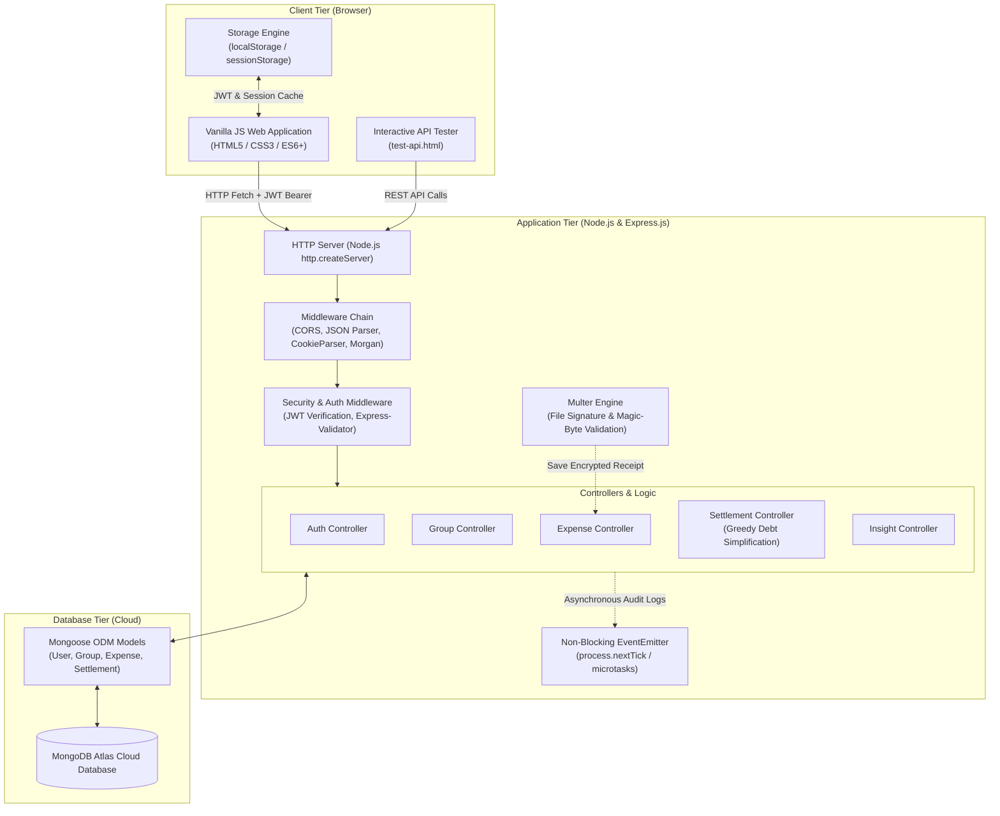
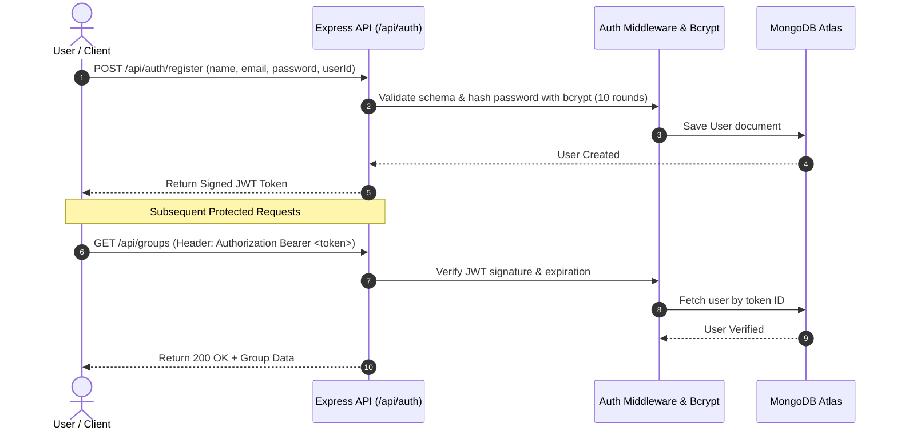
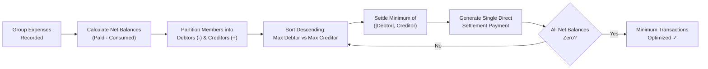

# 💸 Split Bro &mdash; Smart Shared Expense & Debt Simplification Platform

<p align="center">
  
</p>

<p align="center">
  <b>Production-grade Shared Expense Tracker & Settlement Engine</b><br>
  Built with <b>Node.js, Express.js, MongoDB Atlas (Mongoose), and Vanilla JavaScript</b>.<br>
  <i>Chitkara University &bull; 24CAI0303 Back End Engineering &bull; Evaluation-2 (Lectures 25&ndash;41)</i>
</p>

<p align="center">
  <a href="#live-deployment">Live Deployment</a> &bull;
  <a href="#-features">Features</a> &bull;
  <a href="#-system-architecture">Architecture</a> &bull;
  <a href="#-workflow-diagrams">Workflows</a> &bull;
  <a href="#%EF%B8%8F-technology-stack">Tech Stack</a> &bull;
  <a href="#-api-endpoints">API Suite</a> &bull;
  <a href="#-quick-start">Quick Start</a> &bull;
  <a href="#-screenshots">Screenshots</a> &bull;
  <a href="#-team-members">Team</a>
</p>

---

## Live Deployment

- **API Base URL:** https://split-bro-api.onrender.com
- **Health Check:** https://split-bro-api.onrender.com/api/health

The backend is deployed on Render and connects to MongoDB. API endpoints can be tested using Postman or Thunder Client.

---

## 📌 Overview

**Split Bro** is a full-stack shared expense management and debt simplification platform. It allows roommates, travel groups, and event teams to track joint expenses, compute exact shares (equal, percentage, or custom), upload and protect receipt documents, and settle debts with the **mathematical minimum number of payments** using a greedy debt-simplification algorithm.

Originally developed in Evaluation-1 as a client-side prototype, **Evaluation-2 (Lectures 25&ndash;41)** transforms Split Bro into an asynchronous RESTful backend architecture with **JWT Authentication, Multer file upload security, Mongoose schemas, and MongoDB Atlas cloud storage**.

---

## ✨ Features

- 🔐 **JWT Authentication & Bcrypt:** Secure user signup and login with hashed passwords (10 salt rounds) and signed JWT Bearer tokens.
- 👥 **Group Management:** Create groups, generate unique 6-character alphanumeric invite codes, and manage both registered and guest members.
- ➕ **Flexible Expense Splitting:**
  - **Equal (=):** Exact split with remainder cents allocated without precision drift.
  - **Percentage (%):** Real-time validation verifying 100% distribution.
  - **Custom (₹):** Exact individual contributions matching total bill amount.
- 🧾 **Receipt Uploads via Multer:** Attach bill receipts (JPEG, PNG, WEBP, PDF up to 5 MB) with magic-byte file signature validation.
- ⚡ **Greedy Debt Simplification:** Graph-based settlement algorithm that collapses complex group debts into the absolute minimum transactions.
- 📊 **Real-time Analytics:** Category-wise spending breakdowns, group summaries, and user spending metrics.
- 🧪 **Interactive Testing Panel & Automated Test Suite:** Integrated browser API tester (`test-api.html`), 60 passing automated Jest unit/integration tests, and ready-to-run Postman collection.

---

## 🏗️ System Architecture



---

## 🔄 Workflow Diagrams

### 1. User Authentication & JWT Flow (Lecture 39)



### 2. Expense Settlement & Debt Simplification Flow



---

## 🛠️ Technology Stack

| Layer | Technologies Used | Course Reference |
|---|---|---|
| **Backend Runtime** | Node.js (v20+), V8 JavaScript Engine | Lectures 31&ndash;35 |
| **Web Framework** | Express.js 5.x, Router, Middleware | Lectures 37&ndash;38 |
| **Cloud Database** | MongoDB Atlas Cloud, Mongoose ODM | Lecture 41 |
| **Security & Auth** | JSON Web Tokens (JWT), `bcryptjs`, CORS | Lecture 39 |
| **File Storage** | Multer, Magic-Byte File Signature Validator | Lecture 40 |
| **Validation & Core** | `express-validator`, `dotenv`, Node `EventEmitter`, Streams | Lectures 32, 34, 36 |
| **Testing** | Jest, Supertest, MongoDB In-Memory Server (60/60 Tests Passing) | Core Project Verification |
| **Frontend** | HTML5, CSS3, Modern ES6+ JavaScript (`async`/`await`, `fetch`) | Evaluation-1 & Lectures 25&ndash;30 |

---

## 📡 REST API Endpoints

| Category | Method | Route | Description | Auth Required |
|---|---|---|---|:---:|
| **Authentication** | `POST` | `/api/auth/register` | Register new user account with hashed password | No |
| | `POST` | `/api/auth/login` | Authenticate user & issue signed JWT | No |
| | `GET` | `/api/auth/me` | Fetch authenticated user profile | **Yes (Bearer)** |
| | `PATCH` | `/api/auth/me` | Update bio and UPI ID | **Yes (Bearer)** |
| **Groups** | `GET` | `/api/groups` | Fetch all groups current user belongs to | **Yes (Bearer)** |
| | `POST` | `/api/groups` | Create group with members | **Yes (Bearer)** |
| | `GET` | `/api/groups/:id` | Get group details, members, and expenses | **Yes (Bearer)** |
| | `POST` | `/api/groups/join` | Join group via 6-digit group code | **Yes (Bearer)** |
| **Expenses** | `GET` | `/api/expenses` | List group expenses with payer information | **Yes (Bearer)** |
| | `POST` | `/api/expenses` | Add expense (supports multipart receipt upload) | **Yes (Bearer)** |
| | `GET` | `/api/expenses/:id/receipt` | Stream protected receipt file | **Yes (Bearer)** |
| **Settlements** | `GET` | `/api/settlements` | Run greedy algorithm and return simplified debts | **Yes (Bearer)** |
| | `POST` | `/api/settlements` | Record settlement payment between two members | **Yes (Bearer)** |
| **Insights** | `GET` | `/api/insights/group/:id` | Aggregated group spending and category breakdown | **Yes (Bearer)** |
| | `GET` | `/api/insights/user` | User total paid and net balance summary | **Yes (Bearer)** |
| **Diagnostics** | `GET` | `/api/health` | Node uptime, V8 heap memory stats, and Atlas status | No (Public) |

---

## 🚀 Quick Start

### 1. Prerequisites
- **Node.js** v18+ installed
- Internet connection (for cloud MongoDB Atlas)

### 2. Installation
```powershell
# Clone the repository
git clone https://github.com/SATVIX999/Split.bro.git
cd Split.bro/backend

# Install backend dependencies
npm install
```

### 3. Environment Configuration
Create a `.env` file in the `backend/` folder (or use `backend/.env.example` as a template):
```env
PORT=3000
NODE_ENV=development
MONGO_URI=mongodb+srv://<username>:<password>@cluster0.mongodb.net/splitbro?retryWrites=true&w=majority
JWT_SECRET=your_secure_jwt_secret_key_here
JWT_EXPIRES_IN=7d
CORS_ORIGIN=http://localhost:3000,http://127.0.0.1:3000,http://localhost:5500,http://127.0.0.1:5500
```

### 4. Run the Project
```powershell
# Start the backend server (from backend/ directory)
npm start
# Or directly: node src/server.js

# Run the automated test suite (70 tests)
npm test
```

Access the application in your browser:
- **Main Website:** `http://localhost:3000`
- **Interactive API Testing Panel:** `http://localhost:3000/test-api.html`
- **Health Check & Diagnostics:** `http://localhost:3000/api/health`

---

## 📸 Screenshots

<div align="center">

### 1. Landing Page & Hero Section


<br/><br/>

### 2. Group Dashboard & Balance Overview


<br/><br/>

### 3. Add Expense & Split Configuration


<br/><br/>

### 4. Smart Settlement & Debt Simplification


<br/><br/>

### 5. Group Management & Joining with Code


<br/><br/>

### 6. Analytics & Category Insights


<br/><br/>

### 7. User Profile & Settings


<br/><br/>

### 8. Full Application Interface Gallery


<br/>


<br/>


<br/>


<br/>


</div>

---

## 👨‍💻 Team Members

| Name | Roll Number | Role |
|---|:---:|---|
| **Mayur Mittal** | `2410993231` | Back End Architecture, Express REST APIs, MongoDB Atlas & Security |
| **Satvik Sharma** | `2410992972` | Front End UI/UX, Group Logic & DOM Integration |
| **Shriya Kathuria** | `2410992888` | Expense History, Settlements & Documentation |

---

<p align="center">
  <b>Chitkara University &bull; Continuous Assessment 2 (2026)</b><br>
  Built with care for transparent, fair expense sharing.
</p>
